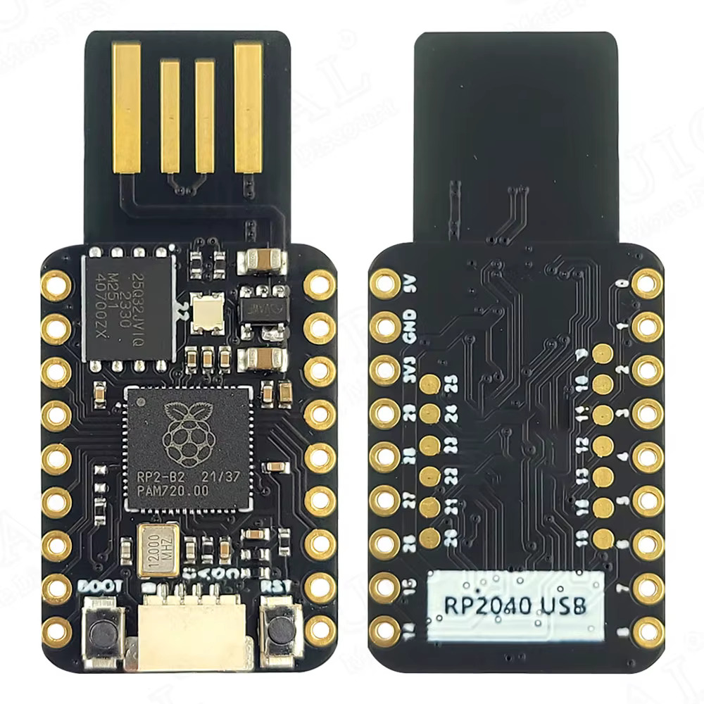

# Hardware notes

## Parts

| Part | Details |
|---|---|
| Display | 3.5" SPI TFT, **ILI9488**, **480 × 320** landscape, 18-bit colour over SPI, 3.3 V logic |
| MCU board | Generic **"RP2040 USB" stick**: RP2040-B2, 12 MHz crystal, W25Q32JV 4 MB QSPI flash, USB-A plug, BOOT and RST buttons |

### RP2040 USB stick pinout

| Location | Pins |
|---|---|
| Edge, power side | 5V, GND, 3V3, GP29, GP28, GP27, GP26, GP15, GP14 |
| Edge, GPIO side | GP0 – GP8 |
| Inner pads | GP9 – GP13, GP20 – GP25 |
| Not broken out | GP16 – GP19 |

GP16–GP19 (the Pico's usual SPI0 pins) are missing, so the display uses SPI0's
alternate pins GP2 (SCK), GP3 (TX/MOSI) and GP4 (RX/MISO), all on the GP0–GP8 edge.

## Display module

The 3.5" module (the MSP3520 user manual is in the shell-shock branch's `docs/datasheets/`)
has the signal pins below. Check the labels on your module against this table.

| Module pin | Signal | RP2040 USB stick |
|---|---|---|
| VCC | Supply | 3V3 |
| GND | Ground | GND |
| CS | Chip select, active low | GP5 |
| RST | Reset, active low | GP7 |
| DC (or RS) | Data (high) / command (low) | GP6 |
| SDI (MOSI) | SPI data into the panel | GP3 |
| SCK | SPI clock | GP2 |
| SDO (MISO) | SPI data out (status reads only) | GP4 |
| LED / BL | Backlight | GND for always on, or GP8 with `PIN_BL 8` |

The module's touch pins and SD card header aren't used.

BL: on this module the backlight is on when BL is tied to 3V3. If your module lights
only when BL is grounded, wire it to GND instead and keep `PIN_BL -1`.

## Joystick

Seven buttons, each switching its GPIO to GND (see [`src/config.h`](../src/config.h)):

| Button | RP2040 USB stick |
|---|---|
| UP | GP26 |
| DOWN | GP27 |
| LEFT | GP28 |
| RIGHT | GP15 |
| MID (centre) | GP14 |
| SET | GP0 |
| RESET | GP1 |

## Settings to check on the panel

The firmware uses these defaults from the ILI9488 driver. Run the diagnostic first
(hold MID while powering on) to confirm them:

- **Orientation and colour order** (`ILI9488_MADCTL` in `lib/ili9488/include/ili9488.h`,
  currently 0x28, landscape BGR). Mirrored or upside-down output: try 0xE8. Swapped red
  and blue: clear the BGR bit (0x08).
- **SPI clock** (`SPI_BAUD` in `src/config.h`, 15 MHz). Lower it if the picture is noisy.
- **Frame rate.** A full frame is 460 KB, so the firmware sends only the strips that
  changed. Fast-moving pictures will still update at a few frames a second.

## Power

The stick runs from USB. The display takes its supply from the 3V3 pin. Check the
module's current draw, including the backlight, before adding anything else to the 3V3 rail.
